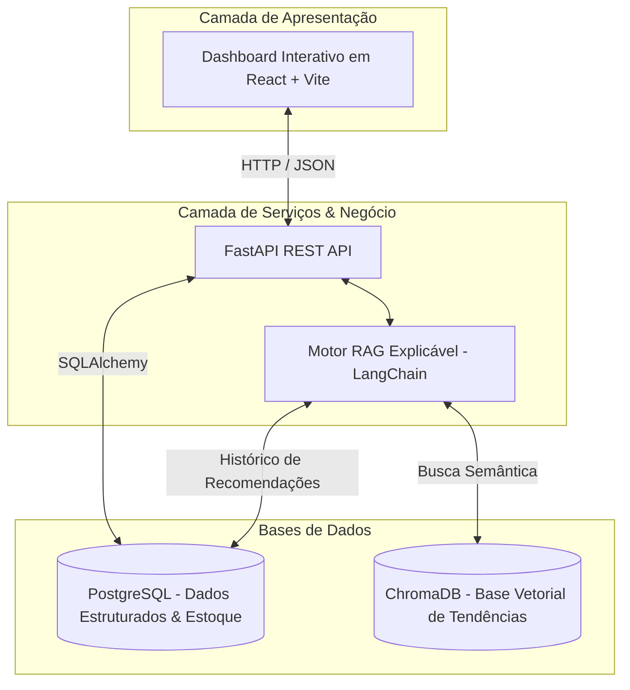

# Moda Inteligente: Sistema RAG para Varejo de Moda Masculina

> **Projeto de Pesquisa Aplicada / Portfólio de Engenharia de Software**  
> **Autora:** Anna Koerich (Católica SC)  
> **Tema:** Arquitetura baseada em *Retrieval-Augmented Generation* para análise de tendências e geração de recomendações no varejo de moda masculina.

---

## 🎯 Objetivo do Projeto
Apoiar pequenos lojistas do segmento de moda masculina na identificação de tendências emergentes e na tomada de decisão sobre aquisição de produtos. A solução visa mitigar erros empíricos de compra, reduzir capital imobilizado em estoque e gerar **recomendações contextualizadas com explicabilidade** (justificando *por que* comprar ou *por que* evitar determinado lote).

---

## 🏗️ Arquitetura e Tecnologias



* **Frontend:** React 19 (Vite, Lucide Icons, Design Responsivo).
* **Backend:** FastAPI (Python 3.14).
* **Banco Relacional:** PostgreSQL (tabelas `produtos`, `tendencias`, `recomendacoes`).
* **Banco Vetorial:** ChromaDB persistente (`./data/chroma_db`).
* **Camada de IA:** LangChain, embeddings semânticos e motor RAG com geração explicável.

---

## 📁 Estrutura de Arquivos

```
projeto-moda/
├── .github/workflows/         # Pipeline CI/CD automatizado (GitHub Actions)
├── data/
│   ├── market_trends.json     # Base de relatórios e evidências de moda masculina
│   └── chroma_db/             # Banco vetorial persistente do ChromaDB
├── docs/
│   ├── WIKI_ARQUITETURA.md    # Documentação C4 Model, DER e fluxos do RAG
│   ├── adr-001-hospedagem-nuvem.md # ADR de decisão de arquitetura em nuvem (Azure VM + Compose)
│   └── conformidade_lgpd_etica.md # Declaração de conformidade LGPD e ética em IA
├── frontend/                  # Aplicação Web em React 19 (Vite + Nginx)
│   ├── src/
│   │   ├── App.jsx            # Dashboard, KPIs, Assistente RAG e Estoque
│   │   ├── App.css            # Estilos personalizados do dashboard
│   │   └── main.jsx
│   ├── Dockerfile             # Build multi-stage para produção
│   ├── nginx.conf             # Servidor Nginx de produção
│   └── package.json
├── tests/                     # Suíte de testes automatizados e avaliação de IA
│   ├── test_api_produtos.py   # Testes da API REST e endpoints
│   ├── test_rag_evaluation.py # Avaliação quantitativa de Hit Rate e latência
│   ├── test_rag_synthesis.py  # Testes de explicabilidade e regras de estoque
│   └── test_vector_db.py      # Testes de busca vetorial no ChromaDB
├── .env.example               # Modelo documentado de variáveis de ambiente
├── .gitignore                 # Regras de proteção de credenciais e caches
├── Caddyfile                  # Servidor Caddy para HTTPS automático Let's Encrypt
├── database.py                # Conexão SQLAlchemy com PostgreSQL
├── models.py                  # Modelos relacionais (Produto, Tendencia, Recomendacao)
├── schemas.py                 # Schemas Pydantic v2 para validação da API
├── vector_db.py               # Módulo de busca por similaridade semântica no ChromaDB
├── rag_engine.py              # Motor RAG com explicabilidade e análise de estoque
├── ingestion.py               # Pipeline de indexação vetorial e sincronização no banco
├── main.py                    # API REST FastAPI com telemetria e healthcheck
├── create_tables.py           # Script para inicialização das tabelas PostgreSQL
├── pyproject.toml             # Configurações do Ruff (linter) e Pytest
├── requirements.txt           # Dependências Python pinned
├── Dockerfile                 # Conteinerização do backend FastAPI
└── docker-compose.yml         # Orquestração de containers (Postgres, API, Frontend, Caddy)
```

---

## 🚀 Como Executar o Projeto

### 1. Via Docker (Recomendado para Produção / Nuvem)
```bash
# Sobe o banco PostgreSQL, backend FastAPI e frontend React Nginx
docker compose up --build -d

# Visualização de logs
docker compose logs -f backend
```
* **Frontend:** `http://localhost:80` (ou IP público na nuvem)
* **API Backend:** `http://localhost:8000`
* **Swagger Interativo:** `http://localhost:8000/docs`
* **Healthcheck:** `http://localhost:8000/health`

### 2. Manualmente (Ambiente de Desenvolvimento Local)
**Terminal 1 (Backend FastAPI):**
```bash
venv\Scripts\uvicorn main:app --reload --port 8000
```
**Terminal 2 (Frontend React):**
```bash
cd frontend
npm run dev
```
* Acesso ao Dashboard local: `http://localhost:5173`

### 3. Testes Automatizados e Linters
```bash
# Executar todos os testes com relatório
venv\Scripts\python -m pytest tests/ -v -s

# Executar linter estático
venv\Scripts\python -m ruff check .
```

---

## 🧠 Como Funciona o Motor RAG com Explicabilidade
1. **Pergunta do Lojista:** O usuário pergunta sobre um produto, corte ou tecido (ex: *"Vale a pena comprar calças skinny?"*).
2. **Recuperação Semântica (ChromaDB):** O sistema busca relatórios de moda, dados de e-commerce e comportamentos de busca mais similares.
3. **Cruzamento com Estoque Real (PostgreSQL):** Caso um produto da loja seja associado, o motor compara a quantidade disponível com o estoque mínimo.
4. **Síntese Explicável:** O sistema gera um retorno estruturado com:
   * **Diagnóstico da Tendência:** o comportamento do mercado.
   * **Ação Recomendada:** Aumentar Pedido, Reduzir Estoque, Não Recomprar, etc.
   * **Nível de Risco de Estoque:** Baixo, Moderado ou Alto.
   * **Justificativa Explicável:** A explicação detalhada dos motivos da decisão, citando as fontes recuperadas.
