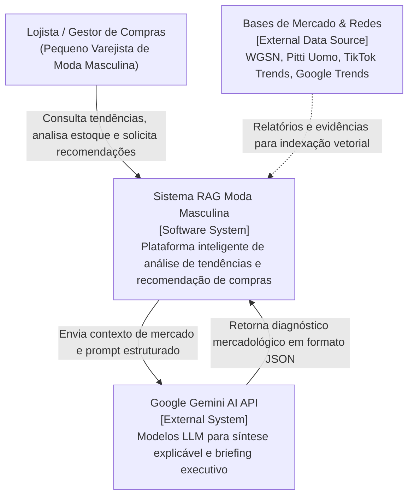
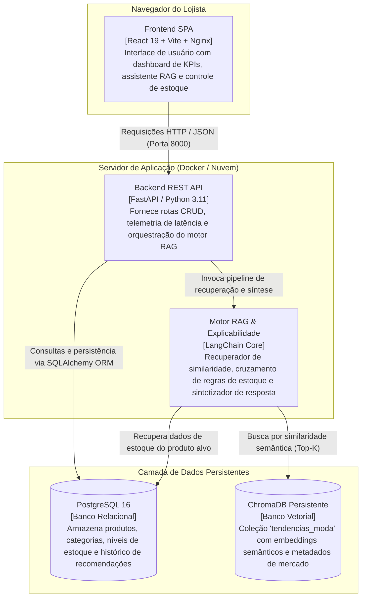
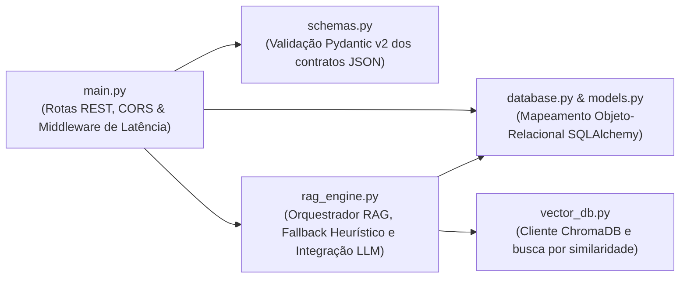
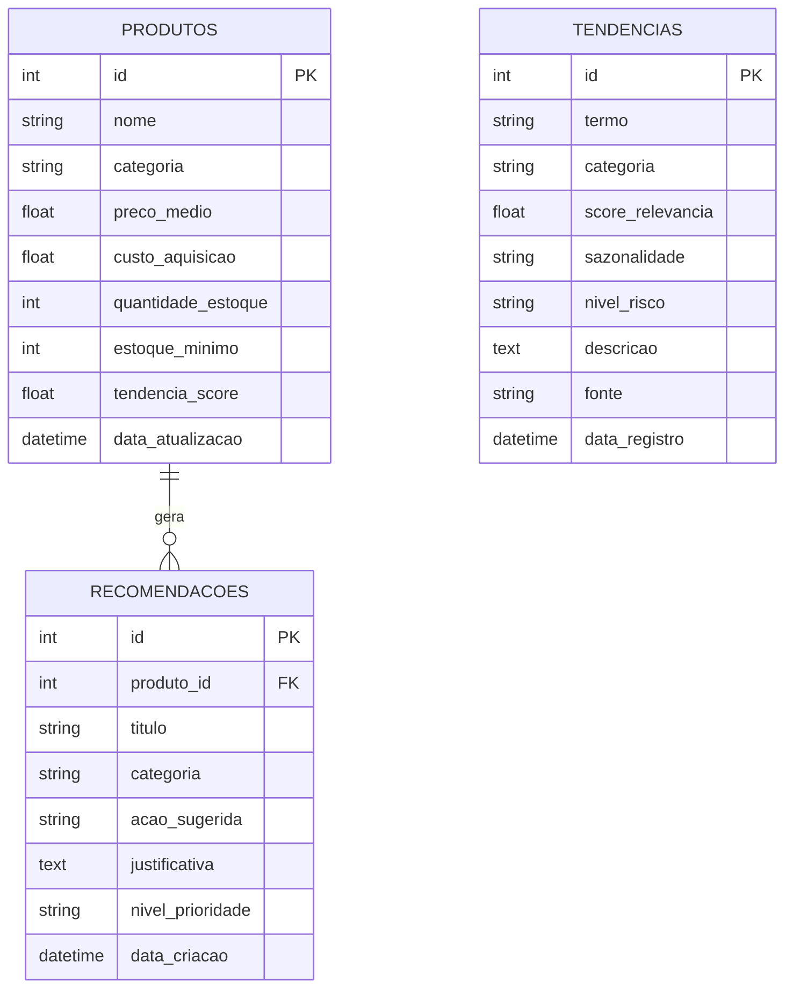
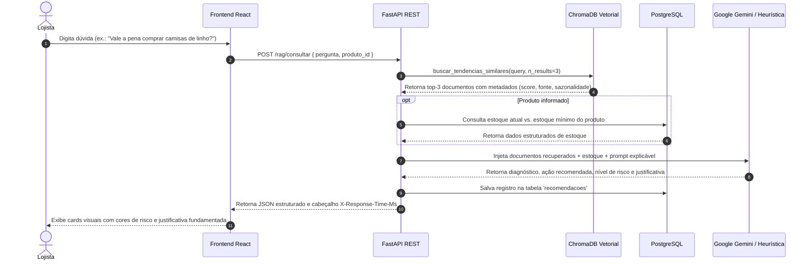

# Documentação de Arquitetura e Engenharia de Software (Wiki Oficial)

**Projeto:** Sistema RAG para Apoio à Tomada de Decisão no Varejo de Moda Masculina  
**Autora:** Anna Koerich  
**Instituição:** Centro Universitário Católica de Santa Catarina (Católica SC)  
**Linha de Projeto:** Inteligência Artificial (IA)  
**Semestre:** 2026/2 — 8º Período  

---

## 1. Visão Geral do Sistema

O **Projeto Moda** foi concebido para resolver o problema crítico de aquisição empírica de produtos e acúmulo de estoque parado em pequenas lojas de moda masculina. Através de uma arquitetura baseada em **Retrieval-Augmented Generation (RAG)**, o sistema correlaciona em tempo real relatórios e evidências do mercado da moda com os dados reais de estoque do lojista, gerando recomendações providas de justificativa transparente (*explicabilidade*).

---

## 2. Modelo C4 de Arquitetura

### 2.1 Nível 1: Diagrama de Contexto
Apresenta os usuários do sistema, os limites da solução e suas integrações com o mundo externo.



---

### 2.2 Nível 2: Diagrama de Containers
Decompõe o sistema em suas unidades de execução e armazenamento independentes.



---

### 2.3 Nível 3: Diagrama de Componentes (Backend FastAPI)
Detalha a organização interna dos módulos da API.



---

## 3. Modelo de Dados Relacional (DER)



---

## 4. Pipeline de Inteligência Artificial & RAG



---

## 5. Núcleo Comum de Engenharia

Em total conformidade com o [Portfólio Directions](file:///C:/Users/annak/Documents/TCC/The-Portfolio-Playbook/directions/portfolio-directions-GERAL.md):

| Requisito do Núcleo | Implementação no Projeto Moda | Status |
| :--- | :--- | :--- |
| **Wiki e Documentação** | Este documento `docs/WIKI_ARQUITETURA.md` integrado ao repositório, com C4 Model e DER. | Concluído |
| **Pipeline de CI/CD** | `.github/workflows/ci.yml` configurado no GitHub Actions executando linters, testes unitários e build do React. | Concluído |
| **Análise Estática de Código** | Ruff configurado no backend (`pyproject.toml`) e Oxlint no frontend React. | Concluído |
| **Monitoramento & Observabilidade** | Middleware de telemetria medindo tempo de resposta em cada requisição (`X-Response-Time-Ms`), logs estruturados e endpoint `/health`. | Concluído |

---

## 6. Instruções de Execução e Deploy

### 6.1 Execução Local com Docker
```bash
# Sobe banco Postgres, backend FastAPI e frontend React
docker compose up --build -d

# Visualização de logs
docker compose logs -f backend
```
- Frontend: `http://localhost:80`
- API Backend: `http://localhost:8000`
- Swagger Interativo: `http://localhost:8000/docs`
- Healthcheck: `http://localhost:8000/health`

### 6.2 Execução sem Docker (Ambiente Virtual)
```bash
# 1. Iniciar Backend
venv\Scripts\uvicorn main:app --reload --port 8000

# 2. Iniciar Frontend
cd frontend
npm run dev
```

### 6.3 Deploy em Nuvem (Azure / AWS / GCP)
Para atender à exigência de ambiente produtivo público e estável:
1. Instanciar uma máquina virtual Linux (Ubuntu 22.04 LTS) na Azure (usando créditos do GitHub Student Pack) ou AWS EC2;
2. Clonar o repositório público do GitHub na máquina remota;
3. Criar o arquivo `.env` com as chaves de produção;
4. Executar `docker compose up -d`.
5. Apontar o IP público ou domínio próprio no pôster técnico (formato A0 com QR Code funcional).
